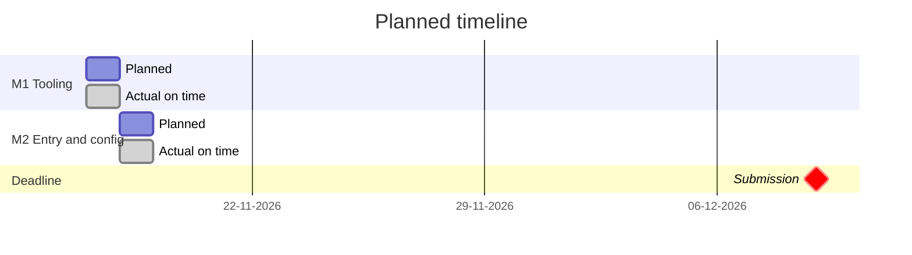

# Timeline (baseline plan)

> Written at the start of the project. **Don't change the planned dates afterwards.** Record
> slips and re-planning in [02_progress.md](02_progress.md).

- **Project start:** 17-11-2026
- **Submission deadline:** 09-12-2026

## Milestones

The "Done when" column holds the acceptance criteria for each milestone.

| # | Milestone | Planned start | Planned end | Done when |
|---|---|---|---|---|
| M1 | Tooling and project setup | 17-11-2026 | 17-11-2026 | Makefile working with uv and with pip |
| M2 | Entry point + config loader | 18-11-2026 | 18-11-2026 | Exactly one argument; every config key validated and clamped; no traceback |
| M3 | Maze adapter | TODO | TODO | Maze model built from `mazegenerator`; generator errors handled |
| M4 | Highscore store | TODO | TODO | Top 10 persisted; survives a missing or corrupt file |
| M5 | Game logic (no graphics) | TODO | TODO | Movement, pacgums, collisions, scoring, lives, timer and levels work |
| M6 | Rendering and screens (pygame-ce) | TODO | TODO | Menu, instructions, highscores, game + HUD, pause, game over, victory |
| M7 | Ghost AI + cheat mode | TODO | TODO | Ghosts chase, flee and respawn; every cheat works |
| M8 | Packaging + itch.io | TODO | TODO | Build from itch.io runs on a 42 machine |
| M9 | README, defense prep | TODO | TODO | README is finished and both of us are ready to defend |

## Gantt chart

<!-- Add one line per milestone once the dates are set. Syntax:
     Name :id, start-date, end-date   or   Name :id, after previous-id, 3d -->

